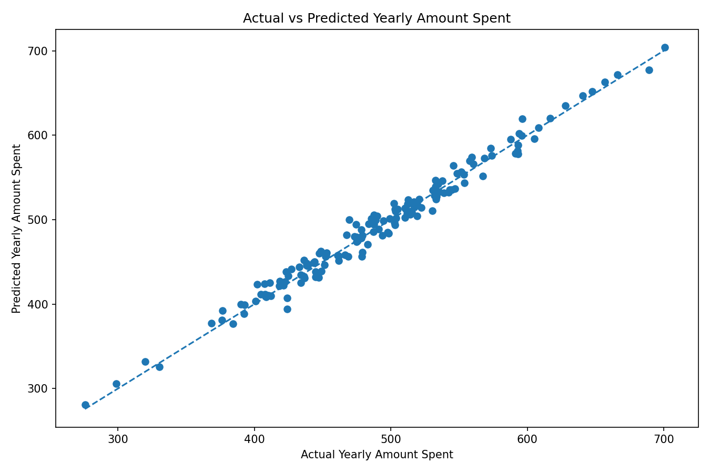
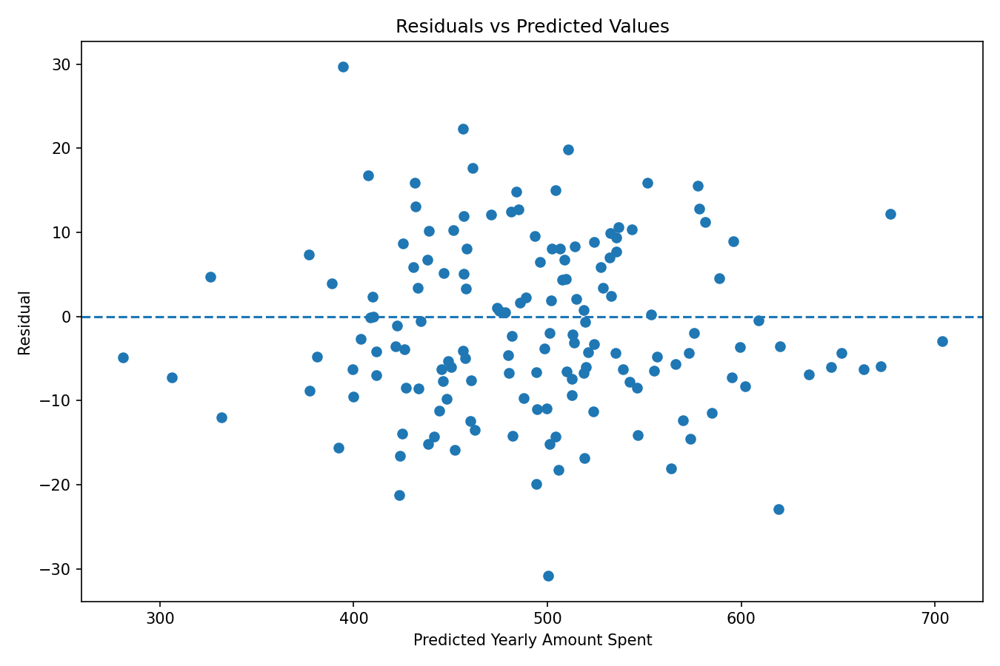
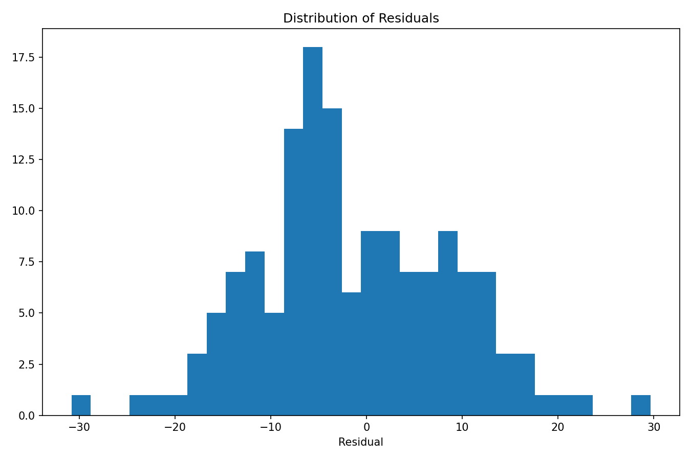
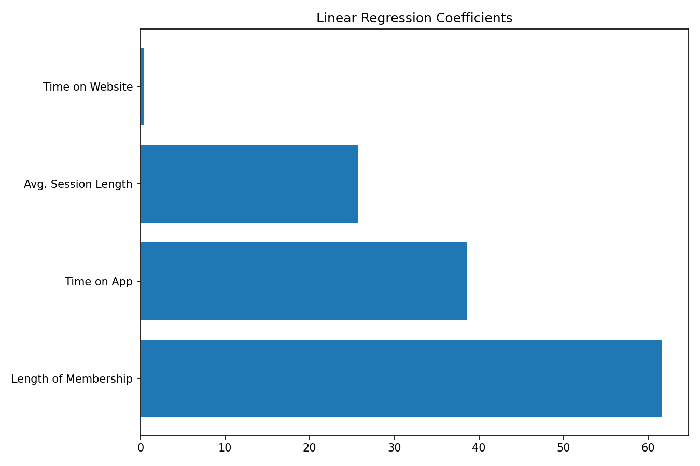

# Ecommerce Customer Spending Prediction

A small machine learning project that uses **Linear Regression** to predict a customer's yearly spending based on their activity and membership information.

The goal is not only to generate predictions, but also to evaluate whether the model generalizes well, inspect its errors, and understand which variables are most strongly associated with predicted yearly spending.

## Dataset

This project uses the **Linear Regression E-commerce Dataset**, published by **Kolawale** on Kaggle:

https://www.kaggle.com/datasets/kolawale/focusing-on-mobile-app-or-website

The dataset contains **500 customer records**. The model uses four numeric features:

- `Avg. Session Length`
- `Time on App`
- `Time on Website`
- `Length of Membership`

Target:

- `Yearly Amount Spent`

The dataset used in this project contains no missing values or duplicated rows.

The dataset itself is not tracked in this repository. Download it from the Kaggle source above and save the file as `data/ecommerce.csv` before running the project.

## Project workflow

1. Load and inspect the dataset.
2. Select numeric predictors and the target variable.
3. Split the data into 70% training and 30% testing sets.
4. Train a Linear Regression model.
5. Evaluate the model with MAE, MSE, RMSE and R².
6. Use 5-fold cross-validation to check the stability of the model.
7. Inspect model coefficients.
8. Analyze residuals and predicted vs. actual values.

## Results

Using `random_state=42`, the test set produced approximately:

| Metric | Result |
|---|---:|
| MAE | 8.43 |
| MSE | 103.92 |
| RMSE | 10.19 |
| R² | 0.9809 |

The 5-fold cross-validation R² scores were approximately:

```text
0.9827, 0.9821, 0.9872, 0.9843, 0.9822
```

Mean cross-validation R²: **0.9837**.

These results suggest that the linear model performs consistently across different subsets of this dataset.

## Model interpretation

The fitted coefficients were approximately:

| Feature | Coefficient |
|---|---:|
| Length of Membership | 61.67 |
| Time on App | 38.60 |
| Avg. Session Length | 25.72 |
| Time on Website | 0.46 |

For this model, `Length of Membership` has the strongest positive coefficient, followed by `Time on App`.

A coefficient should be interpreted while holding the other model features constant. These values show **associations learned by the model**, not proof that increasing one feature will directly cause a customer to spend more.

## Visual analysis

### Actual vs predicted



The closer the points are to the dashed identity line, the closer the model's predictions are to the real values.

### Residuals vs predicted values



This plot helps check whether the prediction errors show an obvious pattern. A mostly random spread around zero is desirable for a linear regression model.

### Residual distribution



The residual distribution provides another view of the model's prediction errors.

### Coefficients



This visualization compares the size of the coefficients learned by the Linear Regression model.

## Project structure

```text
ecommerce-customer-spending-ml/
├── data/
│   └── ecommerce.csv
├── figures/
│   ├── actual_vs_predicted.png
│   ├── coefficients.png
│   ├── residual_distribution.png
│   └── residuals_vs_predicted.png
├── .gitignore
├── main.py
├── README.md
└── requirements.txt
```

## How to run

Clone the repository and enter the project folder:

```bash
git clone <your-repository-url>
cd ecommerce-customer-spending-ml
```

Create and activate a virtual environment:

```bash
python3 -m venv .venv
source .venv/bin/activate
```

Install the dependencies:

```bash
pip install -r requirements.txt
```

Run the project:

```bash
python main.py
```

The program prints the evaluation metrics, cross-validation scores and coefficients in the terminal. It also generates the plots inside the `figures/` directory.

## Limitations and possible next steps

This is a small dataset with only four numeric predictors, and the analysis is predictive rather than causal. A high R² on this dataset does not guarantee the same performance on new customer populations.

Possible extensions include comparing Linear Regression with non-linear models such as Random Forest or Gradient Boosting and investigating whether the additional model complexity produces a meaningful improvement.
